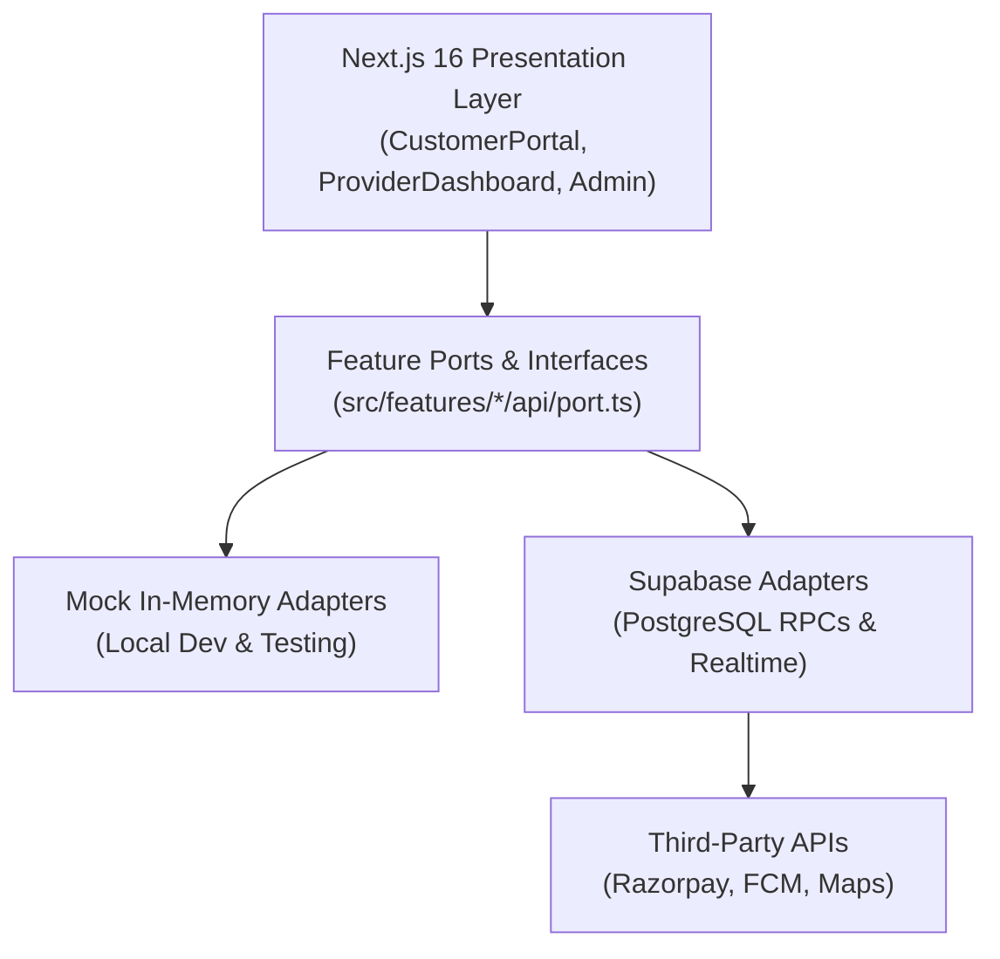

# LocalNest Architecture & Technical Guidelines

This document specifies the technical design, directory layout, data-layer boundaries, and engineering practices for the LocalNest hyperlocal marketplace.

---

## 1. High-Level Architecture Overview

LocalNest is a hyperlocal multi-sided marketplace connecting gated community residents with verified on-demand home service providers and home chefs.



---

## 2. Directory Structure

```
├── .github/                     # Workflows (CI, Dependabot), CODEOWNERS, PR templates
├── docs/                        # Architectural specifications
│   ├── CONTRACT_SPEC.md        # RPC, Edge Function, and API contracts
│   ├── ENVIRONMENTS.md         # Environment tiers & Supabase isolation
│   ├── PAYOUT_ESCROW_DESIGN.md # Escrow hold & Razorpay payout mechanics
│   └── STATIC_EXPORT_DECISION.md # Next.js 16 App Router mobile deployment spike
├── public/                      # Static assets, PWA manifest, service worker
├── src/
│   ├── app/                    # Next.js 16 App Router pages and layout
│   ├── components/             # Reusable UI presentation components
│   ├── features/               # Domain-driven feature modules (Ports & Adapters)
│   │   ├── bookings/           # Booking scheduling, status tracking, cancellations
│   │   ├── chat/               # Masked in-app chat with anti-leakage filtering
│   │   ├── dispatch/           # Uber-style broadcasting, atomic claim, OTPs
│   │   ├── reviews/            # Verified neighbor ratings and reviews
│   │   └── wallet/             # 3% cashback credits, streak bonuses, redemption
│   ├── lib/                    # Shared cross-cutting domain utilities
│   │   ├── __tests__/          # Automated unit test suite (Node test runner)
│   │   ├── env.ts              # Typed environment loader & startup validation
│   │   ├── geo.ts              # Haversine distance, polygon coverage, travel fees
│   │   ├── retentionUtils.ts   # Chat leak prevention, commission calculations
│   │   ├── store.tsx           # Resilient shared React Context (Off-limits)
│   │   └── types.ts            # Canonical domain data types (Backwards-compatible)
│   └── styles/                 # Global styles & CSS tokens
└── supabase/
    ├── migrations/             # Versioned SQL migrations (PostgreSQL)
    └── seed.sql                # Development seed fixtures
```

---

## 3. Data-Layer Rules & Ports/Adapters Pattern

To ensure frictionless development both with and without a live database, all data access follows the **Hexagonal / Ports & Adapters** architecture:

1. **Port Interfaces (`src/features/<feature>/api/port.ts`):**
   - Strictly defines the contract: methods, parameters, and return types.
   - Example: `IDispatchApi`, `IWalletApi`, `IChatApi`.

2. **Adapters:**
   - **Mock Adapter (`mockAdapter.ts`):** Implements the port using in-memory state and local storage. Used during testing and offline development.
   - **Supabase Adapter (`supabaseAdapter.ts`):** Implements the port using PostgREST and database RPCs (`claim_job_request`, etc.).

3. **Factory & Singleton (`index.ts`):**
   - Inspects `env.isMockMode` / `isSupabaseConfigured()`.
   - Returns the active adapter transparently to UI components.

4. **Boundary Rules:**
   - **Never** write raw `fetch` calls or database queries directly inside React UI components.
   - Always route data operations through the feature port or the central context store.

---

## 4. Off-Limits Architectural Files

The following monolithic files contain foundational application logic and require **team consensus and an RFC** before structural edits:

| File                                   | Responsibilities                                          | Restriction Policy                                              |
| :------------------------------------- | :-------------------------------------------------------- | :-------------------------------------------------------------- |
| `src/lib/store.tsx`                    | Global state, order flows, society context, demo fixtures | Off-limits; feature state must migrate to `src/features/` ports |
| `src/components/CustomerPortal.tsx`    | Resident booking, category browsing, order tracking       | Pair review required; extract subcomponents                     |
| `src/components/ProviderDashboard.tsx` | Provider jobs, earnings, availability, radius controls    | Pair review required                                            |
| `src/components/AdminPanel.tsx`        | Society dispatch operations, payouts, commission rules    | Pair review required                                            |

---

## 5. Mobile & PWA Strategy

LocalNest operates a single unified Next.js web application equipped with PWA capabilities (Service Worker, Web App Manifest) and responsive layouts optimized across mobile and desktop viewports. See `docs/STATIC_EXPORT_DECISION.md` for native wrapper and Capacitor evaluation.
